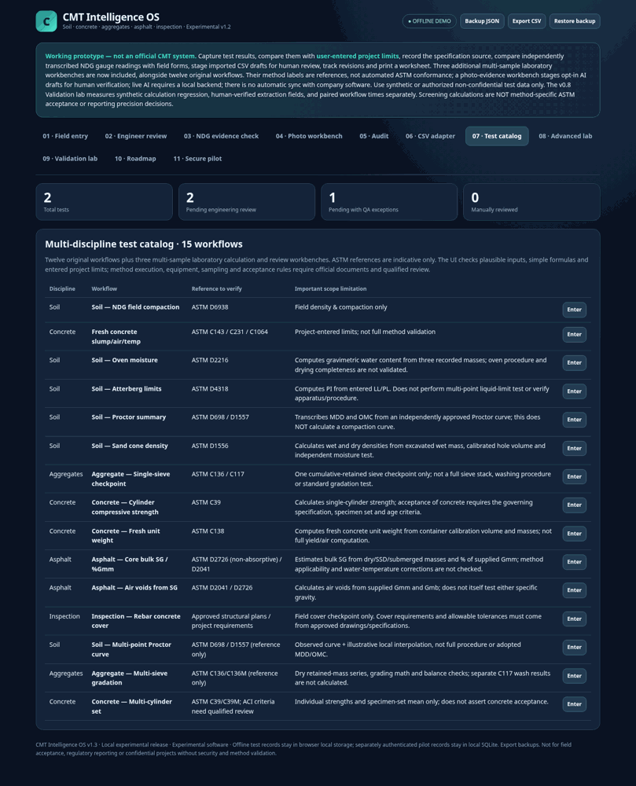

# CMT Intelligence OS

**An experimental AI-assisted workflow for Construction Materials Testing (CMT).**

A vendor-neutral, local-first prototype for processing CMT field/laboratory measurements, spotting inconsistencies, preparing reviewer workflows, and creating **review-only** handoff packages.

> **Status:** Research/demo prototype (v1.4). **Not production-ready, not ASTM/AASHTO-certified, not a professional engineer's signed report.** It has **no live connection to ElmTree** or to any employer's systems. Included records and images are **synthetic examples**.



## Features

- Test-entry and preliminary quality checks across **15 CMT test/inspection workflows**, including soil density, Proctor, Atterberg limits, concrete, aggregate gradation, asphalt, and cover checks.
- Human review queue and local pilot API using Python, FastAPI, and SQLite.
- Prototype image-to-field extraction endpoint with opt-in external model configuration and mandatory manual verification (accuracy on real forms **not validated**).
- Offline, vendor-neutral **ElmTree Bridge concept**: field mapping, explicit units, reviewer gates, duplicate detection, synthetic CSV reconciliation, and checksummed handoff ZIPs. It **does not** use an official ElmTree import interface or API.
- Test/evidence and pilot-benchmark utilities; synthetic test success does not prove field accuracy, compliance, or time savings.

## See it without installing dependencies

Open [`index.html`](index.html) in a desktop browser. For the stand-alone review-only bridge, open [`bridge/ELMTREE_BRIDGE.html`](bridge/ELMTREE_BRIDGE.html).

Some functions (user accounts, server-side persistence, image extraction) require the local Python server.

## Run locally (Python 3.11+)

```bash
python -m venv .venv
# macOS / Linux:
source .venv/bin/activate
# Windows PowerShell:
# .venv\Scripts\Activate.ps1
python -m pip install -r requirements-dev.txt
python -m server.pilot create-user --username techdemo --role technician
python -m server.pilot create-user --username reviewdemo --role engineer
python -m uvicorn server.app:app --host 127.0.0.1 --port 8000
```

Open `http://127.0.0.1:8000`. Create **distinct** users and strong passwords; no default login accounts are provided. Do not expose this local server to the public internet.

## Tests

```bash
python -m pytest -q -k 'not browser'
```

The supplied v1.4 sources passed **110 non-browser tests** during publication preparation. Browser tests require Playwright and its browser installation. The workflows still require independent technical validation against appropriately licensed standards.

## Synthetic data demo for the exchange bridge

```bash
python -m bridge.cli prepare \
  bridge/examples/SYNTHETIC_CMT_RECORDS.json \
  bridge/examples/SYNTHETIC_OPERATOR_PROFILE.json \
  --output bridge_review.csv --synthetic-demo
```

The generated CSV is a **review draft**, not an ElmTree-approved import file. Do not feed it into a production system without explicit authorization and documented format validation.

## Boundaries and privacy

- No live ElmTree integration or affiliation with ElmTree or its vendor. ElmTree is mentioned descriptively.
- Do not upload confidential employer/customer information, personal data, actual work orders, API keys, or internal software screenshots.
- Never use this prototype for official material acceptance decisions; qualified human review remains essential.
- Additional authentication, encryption, data isolation, backup/recovery, security review, regulatory/contractual controls, and approved deployment architecture are needed before production.
- Current data-validation criteria are not universal ASTM/AASHTO acceptance criteria.

See [`README_FA.md`](README_FA.md) for the detailed Persian guide, [`SECURITY_BOUNDARIES_FA.md`](SECURITY_BOUNDARIES_FA.md) for constraints, and [`bridge/README_FA.md`](bridge/README_FA.md) for the bridge usage.

## License

This public preview has **no open-source license** at present; public visibility does not by itself grant permission to reuse or redistribute the code. A license can be added later if the repository owner chooses to open-source it.
